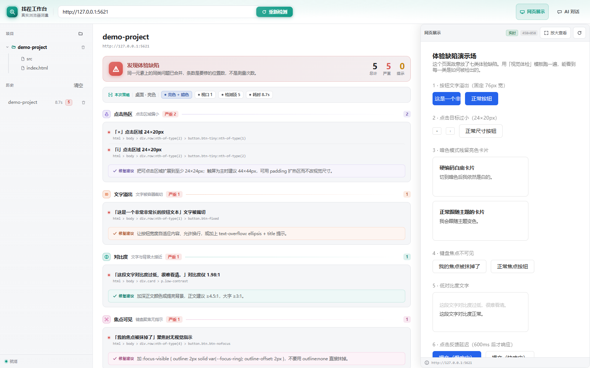
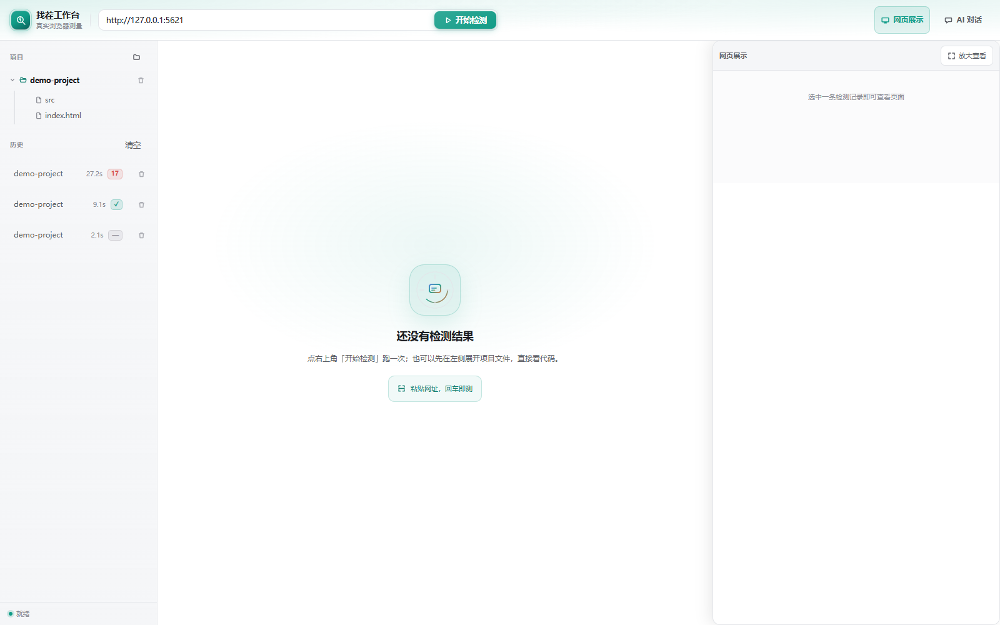
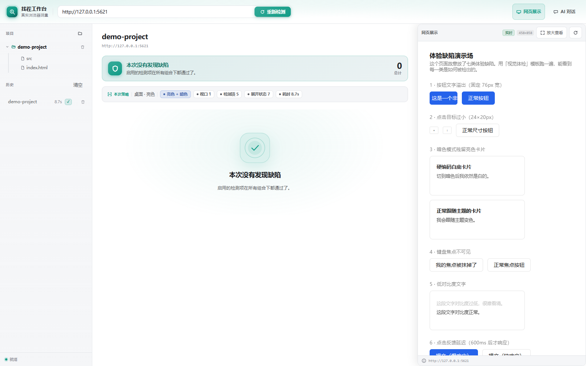

# 找茬工作台



两种用法：**添加一个本地项目文件夹**，或者**直接输入一个网址**。都可以测。

「项目」栏只放项目 —— 本地文件夹和内置演示场。网址不是项目，输进顶部的输入框即测即走，结果留在「历史」里，不会在项目栏堆一串地址。

没有模板要选，没有阈值要配，没有检测项要勾。引擎自己打开页面、判断这个项目到底支持什么，然后在该测的地方测。

## 为什么不用选模板

每个项目不一样。有的有夜间模式，有的没有；有的响应式断点齐全，有的是固定宽度后台。让你先挑一个模板，等于让你替引擎做判断，而引擎自己就能看。

所以点检测之后，引擎按顺序做四件事：

1. **探测主题能力** —— 读 CSS 里的 `prefers-color-scheme`、`html`/`body` 上的 `data-theme`、页面上的主题切换控件。支持暗色就亮暗都测，不支持就只测亮色。
2. **判断响应式** —— 有 `@media` 断点才跑多视口；固定宽度的后台只测当前宽度，不浪费时间。
3. **展开可交互状态** —— 找出折叠面板、Tab、菜单、弹窗触发器等控件，逐个展开并在每个新状态下重新检测，然后恢复原状。
4. **测量** —— 在每个 视口 × 主题 × 状态 的组合下跑全部适用的检测项。

顶部那条「本次策略」会直接告诉你这次为什么这么测。

## 它测什么

| 检测项 | 判据 | 默认阈值 |
|---|---|---|
| 文字溢出裁切 | `scrollWidth > clientWidth` 且被裁切、无 `ellipsis` 兜底 | 必须为 0 |
| 点击目标过小 | `getBoundingClientRect()` | ≥ 44×44px |
| 暗色模式亮色残留 | 暗色下大面积元素的背景相对亮度 | ≤ 0.55，面积 ≥ 2000px² |
| 文字对比度不足 | WCAG 相对亮度比（向上找最近不透明背景） | ≥ 3.0 |
| 键盘焦点不可见 | 逐次 Tab，读 `outline` / `box-shadow` / focus ring | 每站都要可见 |
| 交互反馈延迟 | 点击到出现任意可见变化的耗时 | ≤ 200ms |
| 动画掉帧 | `requestAnimationFrame` 采样帧间隔 | 帧间隔 ≤ 34ms，掉帧率 ≤ 15% |

**框架只执行标准，不制定标准。** 阈值写在 `engine.js` 的 `DETECTORS` 里，改一处全局生效。

## 本地项目文件夹

点「项目」栏标题右边的文件夹图标，选一个目录。工作台会把这个目录跑起来，然后测它：

- 有 `dev` / `start` / `preview` / `serve` 脚本的，用 `npm run` 起 dev server（自动补 `--host 127.0.0.1 --port`）。
- 纯静态目录不起脚本，用内置静态服务托管，不需要装任何依赖。
- 只监听 `127.0.0.1`，端口从 5173 起找空闲的；已在运行的直接复用，反复点不会堆出一排端口。
- 换端口前会先探活：5173 上若是别的服务，会跳过它而不是把别人的页面当成你的。

## 右侧页面：内置浏览器

检测完成后，右半边是一个真的浏览器视图，显示的就是被测的那个页面 —— 能滚、能点、能看出交互效果，不是一张截图。

- **点左侧任意一条缺陷**，右侧页面平滑滚到对应元素，并画一圈高亮框出来，几秒后自己淡出。
- **点的是暗色组合的缺陷，画面就是暗色的**：每条缺陷记住自己测出时的视口与主题，定位时回到同一个环境，否则框出来的位置和颜色都对不上。
- **没有坐标的缺陷**（比如整页动画掉帧）退化成静态行，不做假的点击承诺。
- 顶栏的「页面同步」可以随时收起这一栏。

实现上，面板所在端口和项目端口不同就是跨域，跨域时父窗口读不到 `iframe` 里的 DOM，「点缺陷跳过去」就做不到。所以页面经 `/live` 同源代理加载：转发 HTML 并注入 `<base href>`，让页面里的 JS / CSS / fetch 仍去真实服务取。代理只放行本机回环地址，不做成能读内网的跳板；也刻意不透传 `X-Frame-Options` / CSP，否则页面根本嵌不进来。

线上站点不代理 —— 那是给别人部署的站点，中转其内容既不可靠也不合适。这类地址退回服务端截图，能看能定位，但不可交互。

会话是宿主的进程：关掉面板即回收，闲置 3 分钟自动关闭，不留后台浏览器。没有 Chrome / Edge 的机器上预览退化成纯报告视图，检测功能不受影响。

## 关键设计约束

- **`darkLeak` 只在暗色下运行**。在亮色页面找「亮色大色块」只会得到一片误报。
- **只观察，不破坏**。自动展开控件时排除删除、提交、支付、退出登录一类动作；只点开，不确认。
- **只用本机已装的 Chrome / Edge**（`playwright-core`），不下载浏览器内核。
- **面板自身全部使用宿主主题变量**，不在自己的界面上复现它要检测的那个缺陷。
- **不自己实现对话**。聊天用宿主提供的会话节点，检测能力不依赖模型服务是否存在。

## 内置演示场

预置项目「体验缺陷演示场」指向内置演示页，页面上故意放了七类缺陷。第一次用先跑它，能直观看到每种缺陷是怎么被检出的。

## 中途停止

一次检测可能要跑几分钟：每个视口 × 主题组合都要先扫首屏，再把页面上的菜单、弹窗、表单逐个点开扫一遍。所以「开始检测」在检测期间会变成**停止**按钮，点了就中断。

- **停止不是失败。** 结果标记为「已停止」，不报错，也不当成一次有结论的检测。
- **已经发现的东西会留下。** 停在第 3 个组合，前 2 个组合的缺陷照常进报告和历史记录。停止不等于白跑。
- **停得快。** 每个耗时环节开头都有检查点：组合之间、自动展开的每个控件之前。点了立刻停，不会等剩下几个组合跑完，也不会在收尾时白重载一次页面。
- **按钮立刻回到可用**，不等浏览器那边收尾 —— 否则「点了没反应」会让人再点一次。

## 和 AI 对话

面板右侧的对话栏**就是宿主自己的会话**，不是工作台另做的一套。

- **和左侧会话栏是同一份**：在侧栏新建、删除、切换、重命名会话，对话栏跟着变。
- **包含宿主全部能力**：模型选择、审批、附件、子会话视图，都和主界面一致。
- **没有自建的消息存储**，历史只存在宿主的会话里，不会出现两份记录。
- **还没绑定会话时**（第一次打开这个工作台），会先自我介绍「我是体验测试 AI」+ 能测什么 + 三条可以直接照着说的开场指令，再给「在此工作区新建会话」—— 点了才创建，不会在侧栏里悄悄留下你没要过的会话。

### 会话身份：装上就有

工作台里的会话不是一张白纸。插件装载时会往系统提示里加一段身份说明，只对**属于本工作台的会话**生效（按 `desktop-workbenches/state.json` 的 `sessionBindings` 判断，读不到就当作不属于，绝不污染原生会话）：

- 你是体验测试 AI，直接操作这个工作台，而不是介绍测试方法；
- 客户没说测什么时主动开场，给出可点的下一步；
- 项目名先在工作台里解析，不要先去磁盘翻文件夹；
- 必须真跑 `ux_run_check`，不能用「你可以这样测」代替；
- 测完必须用 `ux_save_report` 把结论写回工作台；
- 「没测成」不能说成「没问题」。

老会话绑定的是旧 id（`dsh-workbench/dshuxworkbench`），新会话是 `jokerghb/ux-workbench`，两个都认，升级不会丢身份。

### 随包下发的技能

`skills/ux-experience-check/SKILL.md` 跟着包装进来，装载时用 `ctx.skills.register()` 登记成 `ux-experience-check`。内容是「怎么决定测什么 → 怎么读分组结果 → 每种缺陷该怎么修 → 结论怎么写」的一套流程，不用用户自己去技能目录放文件。

宿主没有 `skills` 服务（老版本）时只是少一个技能，工作台其它功能照常。

实现上是把宿主通过 `props.conversation` 传进来的节点放进面板布局。工作台规范对此有明确要求：

> 原生会话由宿主提供的 `conversation` 节点放进业务布局，不能再创建一套聊天界面。

早先这里自己写过一个对话面板（`/chat` + SSE + 自己的消息列表），结构上就和侧栏不连通 —— 侧栏里的会话它看不见，历史也各存一份。那套代码已经删掉了。

## Agent 工具

### 体验检测

- `ux_run_check`：给一个网址、项目名或本地项目文件夹路径就跑，返回按检测项分组的缺陷清单
- `ux_start_project`：启动（或复用）项目的本地服务，返回真正能打开的网址和测试方式
- `ux_create_instance`：把本地项目文件夹登记成可反复测的项目
- `ux_list_instances`：列出已登记的项目
- `ux_save_report`：把这次检测的结论（Markdown）写回工作台存档
- `ux_list_reports`：读以前写过的结论，便于对比「修了没有」

### 功能测试

- `ux_save_function_report`：把按用例判定的功能结论写回工作台（`cases[]` + Markdown 正文）
- `ux_list_function_reports`：读以前写过的功能报告

这两组工具**没有重叠**。功能测试的执行者是 AI + `ai-harness-testing` 技能，工作台不跑第二套执行器 —— 它只负责收结论和渲染。

## 两种测试，两条链路

工作台顶栏有个模式开关：**体验检测** / **功能测试**。它不是筛选项，是两套完全分开的东西。

|  | 体验检测 | 功能测试 |
| --- | --- | --- |
| 回答的问题 | 页面**好不好用** | 功能**对不对** |
| 谁来测 | 内置引擎（Playwright） | AI + `ai-harness-testing` 技能 |
| 判定依据 | 测量值（像素、对比度、毫秒） | 用例的预期 vs 实际 |
| 结论单位 | 缺陷（N 处要改） | 用例（通过 / 失败 / 阻塞） |
| 存放 | `runs/` + `reports/` | `functional-reports/` |
| 接口 | `/runs`、`/report(s)` | `/functional/report(s)` |
| 渲染 | 按检测器分组的缺陷行 | 按状态分组的用例卡片 |
| 右侧网页展示 | 有 | 有 |

分开到什么程度：两个模式之间**不共享任何一个字段、一条列表、一种渲染器**。左栏历史都整体切换，不是同一个列表加过滤 —— 一个列表里混着「测出 29 处缺陷」和「通过 12 失败 3」，数字量纲都不一样，用户没法比较也没法信任。

### 右侧网页展示：地址栏可以就地换页

两种模式都有「网页展示」。它自带一条地址栏：一个项目往往不止一个页面（首页、后台、详情、登录后的路由），要看的地址直接在这一行改，回车即换，**不用回到顶部重跑一次检测，也不用先有一条记录**。

- 本机地址走 `/live` 同源代理，iframe 里是真页面，能滚能点；线上地址退回服务端截图，能看能定位但不可交互。
- 没写协议会自动补 `http://`（`127.0.0.1:5173`、`localhost:3000` 都能直接填）。
- 功能模式没有记录可点，打开时先把当前项目页面摆进去；换项目时这个自动摆放的页面会跟着换，但你手动填过的地址不会被顶掉。

体验模式下顶部那个输入框回答的是「要测哪个网址」，地址栏回答的是「现在右侧看哪个页面」—— 两件事，所以是两行，不是重复。

体验模式下引擎把「测出来什么」写进 `runs/`；用户要不要改、先改哪个，由 AI 写在 `reports/` 里，**只在对话里读**，面板不画第二份。

### 功能测试为什么没有「发起」按钮

功能测试的判定靠「这条用例该发生什么、实际发生了什么」。这需要理解需求、造数据、判断意外情况 —— 技能里那套流程已经在做，再写一个执行器只会变成第二套半成品。

所以面板只做两件事：收结论（轮询 `functional-reports/`）、渲染。

**发起就在右侧对话里说一句**：「测一下 xx 项目的登录功能」。AI 那边有完整规则 —— 先问你要哪种测试、功能测试必须加载 `ai-harness-testing` 技能、测完必须用 `ux_save_function_report` 写回。

早先这里做过一个「发起功能测试」按钮，会替用户往对话里发一段固定工单。删掉了，三个理由：

- 它只能拿「左栏选中的项目」当目标，你心里想的是另一个项目时，工单就发错了，而且你未必看得到那条工单；
- 你说「测一下支付流程」比工单里那几行管用 —— 按钮把话替你说了一半，反而要绕；
- 多一条会随宿主 API 变坏的链路（`conversation.send` → `setDraft` → 让用户复制文本），换来的只是省一次打字。不值。

想长期防回归的用例，应该固化成可执行回归去「功能测试工作台」跑确定性执行。这句提示放在报告底部，用户读完结论才需要考虑下一步。

### 检测结果与结论是两回事

引擎只给测量事实（几处、在哪里、怎么修），「能不能上线 / 先修哪个」是判断。

- 结论存在 `.ux-workbench/reports/`，和 `runs/` 平级；**清空检测历史不会删掉结论**；
- 结论**只在对话里读**，面板不画第二份 —— 两样东西挤一屏会让人分不清哪个是测出来的；
- 服务端仍提供 `ux_save_report` / `ux_list_reports` 与 `/reports` 路由，数据是持久的。

功能测试的报告是**例外**：那份东西本身就是结论（用例级判定），单位清晰、没有「测量 vs 判断」的混淆，所以它直接渲染在主区。两类的差别在于「面板画的是什么」，不在于「结论存不存」。

### 从对话里直接测

用户说「帮我启动 xxx」「测一下 xxx」「检测 https://…」时，AI 先把名字**在工作台里**解析（`ux_list_instances` / 按名字匹配），而不是先去磁盘翻文件夹；只有在工作台里匹配不到时，才回退到电脑上的路径。

启动后返回的网址是**实际托管出来的地址**，不是猜的：

- 根目录有 `dev/start/preview` 脚本 → 用它；
- 没有就看子目录（`frontend/`、`web/`、`client/` … 或已构建的 `dist/`）；
- 只有静态 `index.html` → 内置静态服务托管；
- 完全没有前端页面 → 明确说「没有可测的东西」，不编网址。

面板会轮询项目列表与运行记录，所以 AI 起的服务、跑出的报告会自动出现在界面上，不需要手动刷新。

### 没测成，就不算一次检测

「页面打不开」和「页面没缺陷」在报告里都是 0 处缺陷，但前者一个像素都没测到。

所以只要页面没正常打开（网址错、服务没起、返回 4xx/5xx、连接被拒），这次检测**不写运行记录**：

- 历史列表里不会多一条 —— 否则它会长期躺在那儿，被读成「测过了、没问题」；
- 面板显示「本次检测没有完成」+ 具体原因，不是绿色的「本次没有发现缺陷」；
- 历史徽标用灰色 `—`，不用绿色 `✓`；
- 对话里明确说「没有产生运行记录」，并强调这不是「没有发现缺陷」。

三种结局在界面上必须分得开：`有缺陷`（数字 + 红）、`测完干净`（✓ + 绿）、`没测成`（— + 灰）。



测完真的干净时，不摆一张空表格，直接说没有发现缺陷：



## 安装

在 Desktop 的「工作台 › 市场」里搜索「找茬工作台」直接安装，装完重启 Harness。

也可以从 Release 手动装：下载对应版本的 `.tgz`，在 Desktop 的「已安装的工作台」里选择该文件安装，重启 Harness。

从源码装（开发者）：

```bash
git clone https://github.com/JokerGHB/ux-workbench.git
cd ux-workbench
pnpm install && pnpm pack
# 然后在 Desktop 的「已安装的工作台」里安装生成的 .tgz，重启 Harness
```

首次运行检测时需要本机有 Edge 或 Chrome，工作台会自己找。驱动用 `playwright-core`，已作为依赖声明，不需要另外装浏览器内核。

数据落在 `dshHomePath('ux-workbench')`：`instances.json` 与 `runs/`。卸载工作台不删用户数据。

## 目录

```
package.json          npm + DSH 插件声明
cordis.patch.yml      服务端入口插入插件树
dsh/index.js          服务端入口：API 路由、任务调度、Agent 工具
dsh/project.js        本地项目服务：静态托管或 npm 脚本，端口分配与停启
dsh/explore.js        自动探索：主题探测、状态发现与展开、视口建议
dsh/engine.js         检测引擎：7 个检测器 + 浏览器探测 + 自动决策
dsh/preview.js        同步预览：真实页面会话、截图、定位与描框
dsh/errors.js         浏览器报错翻译：错误码 → 中文原因 + 该怎么办
dsh/cancel.js         中断语义：检查点、已停止判断、RunAborted
dsh/templates.js      出厂默认值与预置项目
dsh/demo.html         内置演示场
dsh/agent-persona.mjs 会话身份：只有本工作台的会话才看到「体验测试 AI」
skills/               随包下发的技能（ux-experience-check）
lib/client.js         客户端面板（已构建的单文件模块）
test/                 身份段落与工作台文件夹的单元测试
```

## 已知边界

- **交互反馈与掉帧检测会真的点击页面按钮**，不要在会写数据的生产环境跑。
- **自动展开会点开菜单和弹窗**，虽然排除了危险动作，但仍建议在测试环境使用。
- 掉帧率受机器性能影响；CI 上跑建议把 `maxJankRatio` 放宽到 0.3。
- 焦点检测会连续按 Tab，页面会滚动，属正常现象。
- 移动端只做视口模拟，不驱动真机。
- **本机项目是可交互的，线上网址是截图**：本地项目走同源代理，右侧能滚能点也能高亮定位；线上站点受浏览器安全策略限制只能给截图。
- **它不会「发现」你没预期的体验问题**：阈值是人定的，它只守住这条线。找问题靠人工走查和会话回放，防复发靠这套检测。

## 许可

MIT